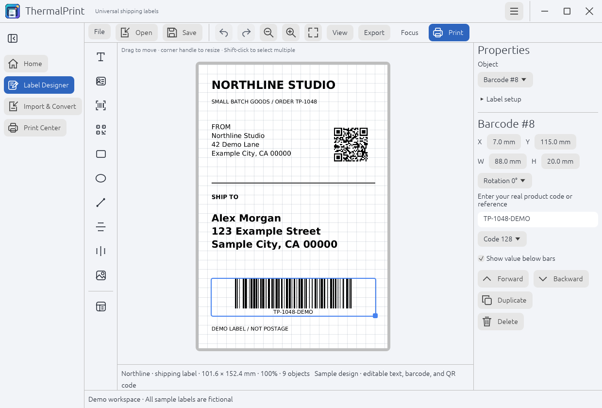
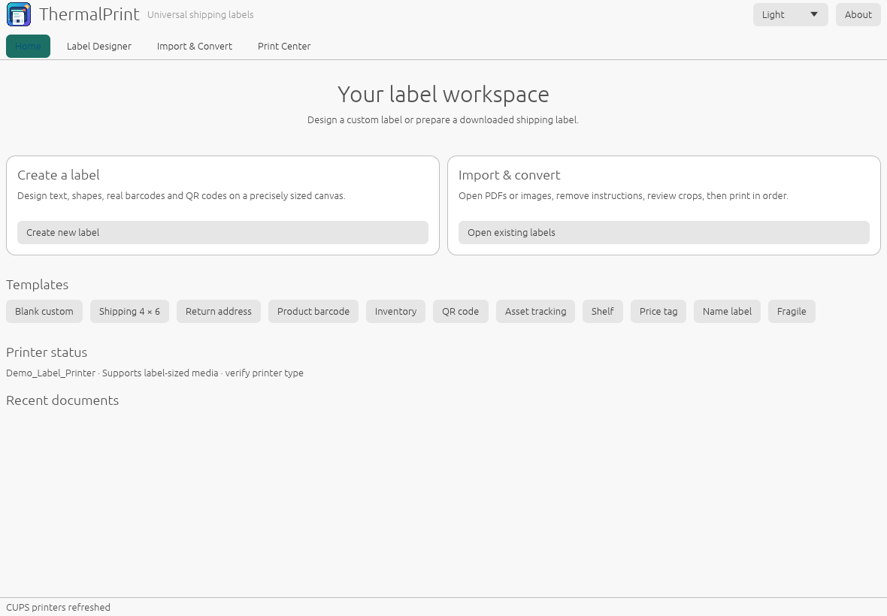
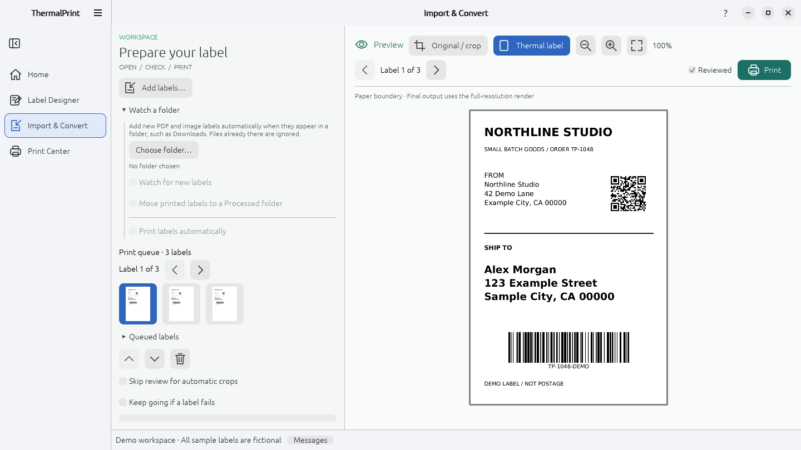
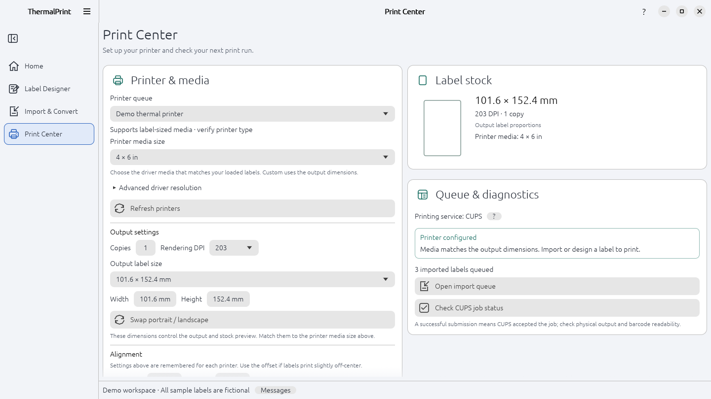
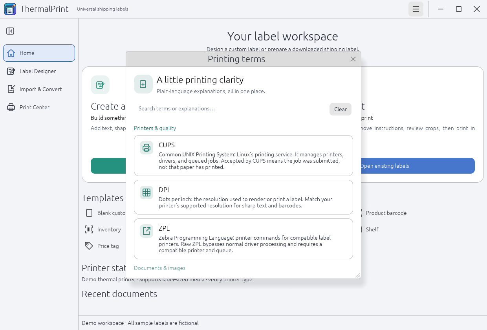

<div align="center">


# ThermalPrint

**Your labels. Your printer. Your Linux desktop.**

Design custom labels, prepare downloaded PDFs, and print on thermal stock—all in one local workspace.

[](https://github.com/arios4k/thermalprint/releases/latest)
[](https://github.com/arios4k/thermalprint/actions/workflows/ci.yml)
[](https://github.com/arios4k/thermalprint/actions/workflows/release-rpm.yml)
[](#debian--ubuntu)
[](https://copr.fedorainfracloud.org/coprs/arios/thermalprint/)
[](https://snapcraft.io/thermalprint)
[](LICENSE)

[Install on Fedora](#fedora) · [Install on Debian / Ubuntu](#debian--ubuntu) · [See the app](#screenshots) · [Download packages](https://github.com/arios4k/thermalprint/releases/latest)

<picture>
  <source media="(prefers-color-scheme: dark)" srcset="docs/screenshots/designer-dark.png">
  
</picture>

<sub>Actual app screenshots from the current source, with fictional sample data. The demo label is not postage. Light and dark images follow your GitHub theme.</sub>

</div>

## A workspace for everyday labels

- **Create your own.** Start with a template and add text, addresses, logos, shapes, real barcodes, and QR codes. Position objects precisely, align with grid snapping, and save reusable designs.
- **Prepare existing labels.** Import PDFs or images, crop instructions and whitespace, review the result, and arrange several labels into a print queue.
- **Get the size right.** Start at **4 × 6 inches**, choose another preset or enter custom dimensions. Descriptive printer media names and one-click size matching help resolve mismatches.
- **Print or export.** Submit to a configured CUPS printer, save a dimensioned PDF or PNG, or export a design as SVG or raster ZPL.
- **Print many at once.** Merge a spreadsheet into a design: put `${column}` placeholders in text, barcode, and QR content, choose a CSV file, preview any row, and print one label per row. Every row is checked before anything is sent.
- **Fit your printer.** Each printer remembers its media, resolution, size, and copies, plus a small alignment offset. Print a ruler test label to measure how far your printer is off-center.
- **Save clicks.** Watch a folder such as Downloads and new PDF and image labels join the queue on their own. Recent prints are listed in Print Center so a label can be reopened and printed again after you review it.
- **Stay comfortable.** A single title bar with the app menu and window controls; light, dark, and system themes; English, Spanish, German, and French (following your system language); consistent icon tools; keyboard shortcuts; and a searchable guide explaining printing terminology.

Document processing happens on your computer. ThermalPrint works with local files from carriers and marketplaces, including Vinted, eBay, Etsy, Shopify, USPS, UPS, and FedEx, without connecting to their accounts.

## Install

Packages include the application, desktop launcher, icons, CUPS client tools, and Poppler PDF utilities. Configure your printer in your desktop's printer settings, then launch **ThermalPrint** from the applications menu.

### Fedora

For **Fedora 44 and 45, x86_64**, enable the community Copr repository once:

```sh
sudo dnf install dnf5-plugins
sudo dnf copr enable arios/thermalprint
sudo dnf install thermalprint
```

Updates arrive through normal DNF updates. [View the Copr repository](https://copr.fedorainfracloud.org/coprs/arios/thermalprint/). Copr is separate from Fedora's official package repositories.

### Debian / Ubuntu

The signed APT repository provides **amd64** packages:

```sh
sudo apt update
sudo apt install curl
sudo install -d -m 0755 /etc/apt/keyrings
curl -fsSL https://arios4k.github.io/thermalprint/key.asc | sudo tee /etc/apt/keyrings/thermalprint.asc >/dev/null
echo 'deb [arch=amd64 signed-by=/etc/apt/keyrings/thermalprint.asc] https://arios4k.github.io/thermalprint/ stable main' | sudo tee /etc/apt/sources.list.d/thermalprint.list >/dev/null
sudo apt update
sudo apt install thermalprint
```

Updates arrive through normal APT updates.

### Snap

Install from the [Snap Store](https://snapcraft.io/thermalprint) (amd64). Tagged releases are published there automatically, and Snap updates itself:

```sh
sudo snap install thermalprint
```

To try a locally built package instead ([build instructions](docs/SNAP.md#build-and-inspect)):

```sh
sudo snap install --dangerous target/snap/thermalprint_*_amd64.snap
snap connections thermalprint
snap run thermalprint
```

If the `cups` row in `snap connections` shows `-` in the Slot column, or ThermalPrint says printing is not connected:

```sh
sudo snap install cups
sudo snap connect thermalprint:cups cups:cups
```

To save labels to USB drives or other removable storage:

```sh
sudo snap connect thermalprint:removable-media
```

To open saved `.thermalprint` labels by double-clicking, run this once from your normal terminal (not `snap run`):

```sh
sh /snap/thermalprint/current/usr/share/doc/thermalprint/register-mime.sh
```

Snap packages cannot run these steps automatically; see [Snap release preparation](docs/SNAP.md) for details.

### Standalone packages and source builds

[GitHub Releases](https://github.com/arios4k/thermalprint/releases) contains the published packages. Tagged releases with the Fedora workflow produce a binary RPM for each supported Fedora version and a source RPM, alongside the Debian package.

Install a downloaded package using your distribution's package manager so its dependencies are installed too:

```sh
# Debian / Ubuntu
sudo apt install ./thermalprint_*.deb

# Fedora — choose the RPM matching your Fedora release
sudo dnf install ./thermalprint-*.x86_64.rpm
```

Run these from the download folder, keeping only the RPM matching your Fedora release there. Other Linux users can [build from source](#build-from-source).

## Screenshots

### An inviting place to start

Choose a blank label, reuse a template, or bring in an existing shipping label. Shipping, return address, product barcode, inventory, QR, asset, shelf, price tag, name, and fragile templates are included.

<picture>
  <source media="(prefers-color-scheme: dark)" srcset="docs/screenshots/home-dark.png">
  
</picture>

### Preview before paper

Compare the original document with the prepared thermal label. Adjust the crop, keep the barcode edges in view, and review each label before printing a batch.

<picture>
  <source media="(prefers-color-scheme: dark)" srcset="docs/screenshots/import-dark.png">
  
</picture>

### Printer setup you can understand

Pick your printer and stock, see the paper proportions, and check readiness. Size warnings explain the mismatch and offer an action to match the output to the selected media.

<picture>
  <source media="(prefers-color-scheme: dark)" srcset="docs/screenshots/print-center-dark.png">
  
</picture>

<details>
<summary><strong>A little printing clarity</strong></summary>

The searchable **Printing terms** window explains CUPS, DPI, document formats, and barcode terminology. Open it from the hamburger menu; contextual help is also available next to relevant controls.

<picture>
  <source media="(prefers-color-scheme: dark)" srcset="docs/screenshots/printing-terms-dark.png">
  
</picture>

</details>

## Your first label

1. **Open or create.** Choose **Import & Convert** for a downloaded PDF/image, or **Label Designer** for a custom layout.
2. **Review.** Check the crop, address, barcode edges, and final preview. Adjust the crop when needed.
3. **Match the paper.** Select the loaded stock and its matching printer media. The default label size is 4 × 6 inches; saved user choices are preserved.
4. **Print or save.** Print the label, arrange a batch, or export a PDF/PNG.

Double-click a saved `.thermalprint` file to open it directly in Label Designer. Before replacing a modified design or closing the app, choose **Save**, **Discard**, or **Cancel**.

Select an object and drag its round handle to rotate freely, including fractional angles. Hold **Shift** to snap to 15° increments, or enter an exact **Rotation** value in Properties.

Use the sidebar icon to collapse navigation. In **Label Designer**, **Focus** hides navigation and properties, **View** controls the grid and properties panel, and **Export** groups PDF, PNG, SVG, and ZPL output. The **Object** picker in Properties lets you select an element using the keyboard.

Useful shortcuts: **Ctrl+O** opens labels, **Ctrl+P** prints, and the designer supports **Ctrl+S**, **Ctrl+Z/Y**, **Ctrl+C/V**, and **Ctrl+D**.

[Detailed usage guide](docs/USAGE.md) · [Troubleshooting](docs/TROUBLESHOOTING.md)

## Formats and compatibility

| Task | Supported formats or options |
| --- | --- |
| Import | PDF, PNG, JPEG, TIFF, BMP, WebP; multipage PDFs join the queue; CSV, semicolon, or tab-separated tables for batch printing |
| Editable designs | Versioned `.thermalprint` files with embedded images |
| Barcodes | Code 128, Code 39, Code 93, EAN-13, EAN-8, UPC-A, ITF, Codabar, Data Matrix, QR |
| Output | PDF, PNG; design SVG with embedded raster output; raster ZPL |
| Layout | Automatic/manual/full-page extraction, rotation, fit/actual/custom scale, margins |
| Print resolution | 203, 300, or 600 DPI |
| Desktop | Linux with X11 or Wayland; configured CUPS printer |

ThermalPrint prepares labels; it does not purchase postage or generate carrier tracking numbers. Raw ZPL requires a compatible printer and deliberately configured raw queue. This is an early release: check a physical test print and scan before relying on a shipping workflow. The app does not currently decode imported barcodes or verify physical scan quality. See the [usage guide](docs/USAGE.md) for processing limits and printer details.

## Build from source

Requires **Rust 1.96+**, a C/C++ build toolchain, and the usual Linux development libraries. Install CUPS client tools and Poppler utilities for printing and PDF fallback support.

```sh
git clone https://github.com/arios4k/thermalprint.git
cd thermalprint
cargo run --release --locked
```

PDFium is optional. To use a custom installation, set `THERMALPRINT_PDFIUM_DIR` to the directory containing `libpdfium.so`.

[Snap packaging](docs/SNAP.md) · [Development and tests](docs/DEVELOPMENT.md) · [Fedora packaging / Copr setup](packaging/rpm/README.md) · [APT release maintenance](docs/RELEASING.md) · [Regenerate screenshots](docs/screenshots/README.md)

## Support ThermalPrint

If ThermalPrint has been useful to you, please consider [making a donation of any amount](https://paypal.me/AlexisRios) to help keep the project running and support its continued development. Every contribution is appreciated.

The intention is to keep ThermalPrint free and available to everyone. Thank you for using it and for any support you can offer!

[](https://paypal.me/AlexisRios)

If ThermalPrint is useful to you, a [GitHub star](https://github.com/arios4k/thermalprint), a reproducible [bug report](https://github.com/arios4k/thermalprint/issues), or sharing it with another Linux user helps the project grow. Keep personal addresses and tracking information out of public reports.

Created by **Alexis Rios-Negron**. Also explore [Voltkit](https://github.com/arios4k/voltkit) and [Battery Health Center](https://github.com/arios4k/battery-health-center).

## License

[MIT](LICENSE) © 2026 Alexis Rios-Negron. Bundled fonts and dependencies retain their own licenses.
