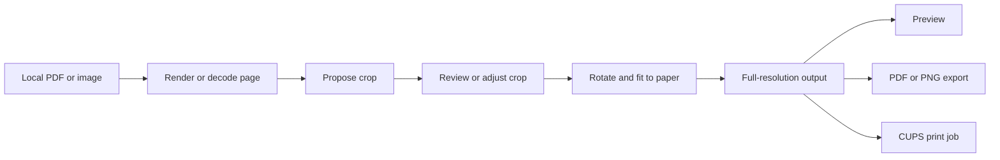

# ThermalPrint

**A thermal label designer and shipping label printer for Linux.** Import downloaded labels, extract the printable area, or design a new label with text, shapes, barcodes, QR codes, and images. Preview and print through CUPS without a marketplace account.

Created by **Alexis Rios-Negron**. Written primarily in Rust and released under the [MIT License](LICENSE).

> **Project status:** This is an early desktop release (`0.1.0`). Imported barcode decoding and physical scan verification are not available. Raw ZPL is available for a compatible CUPS raw queue, using raster commands. Test a physical print with your printer and carrier workflow before relying on it for shipments.

## Why ThermalPrint?

A downloaded shipping label is often inside an A4 or US Letter PDF, surrounded by whitespace or instructions. Printing that entire page on 4 × 6-inch stock can make the address and barcode too small. ThermalPrint separates **cropping whitespace** from **scaling the label**: you choose the content area first, then the app fits it to the paper without changing its proportions.

The app is source agnostic. Use it with downloaded labels from Vinted, eBay, Etsy, Amazon, Shopify, USPS, UPS, FedEx, or another provider that supplies a supported PDF or image. ThermalPrint does not connect to any of those services.

## Features

- **Custom label designer:** Start from a blank canvas or built-in shipping, return, product, inventory, QR, asset, shelf, price, name, or fragile template. Edit object position and size in millimeters, drag and resize on canvas, use grid snapping, layers, undo/redo, copy/paste, duplicate, and multiple selection.
- **Real barcodes and QR codes:** Code 128, Code 39, EAN-13, UPC-A, and QR codes are generated from their encoded values. Add text, addresses, rectangles, lines, circles, and imported logos. Custom labels do not create carrier postage or tracking numbers.
- **Editable documents:** Save and reopen versioned `.thermalprint` JSON designs. Export a design as dimensioned PDF, PNG, SVG with an embedded raster image, or raster ZPL.
- **Four work areas:** Home, Label Designer, Import & Convert, and Print Center.

- **PDF and image import:** PDF, PNG, JPEG, TIFF, BMP, and WebP. Multipage PDFs add their pages to the print queue.
- **Three extraction modes:** Automatic whitespace analysis, interactive Manual cropping, and Full page.
- **Multiple labels:** Add several files at once, drag several files into the window, or queue multiple detected regions from one PDF page. Review, reorder, remove, and print queued labels in sequence.
- **Live preview:** Switch between the original page with its crop boundary and the processed output. Zoom and fit controls are independent of final print resolution.
- **Paper options:** 4 × 6 inches by default, plus 4 × 4 inches, 2 × 1 inches, 100 × 150 mm, and custom dimensions. Portrait and landscape are available by swapping dimensions.
- **Layout options:** 0°, 90°, 180°, and 270° rotation; fit, actual-size, and custom scaling; margins; 203, 300, or 600 DPI; and an optional black-and-white threshold.
- **CUPS printing:** Discover configured printers, advertised media choices, and available resolution choices. Choose copies, submit one label or a queue, and inspect the CUPS queue status.
- **Export:** Dimensioned PDF or PNG with output DPI metadata.
- **Desktop basics:** Light, dark, or system theme; recent files; saved printer preferences; Ctrl+O and Ctrl+P; and an About dialog.

## Get started

### Requirements

- Linux desktop with X11 or Wayland. The project is intended for Ubuntu, Debian, Fedora, Arch Linux, and similar distributions.
- Rust **1.96 or newer** for building the Rust 2024 project.
- A working CUPS installation and the `lp`, `lpstat`, and `lpoptions` client commands for printing. Export works without a configured printer.
- For PDF input, either a compatible **PDFium** shared library (`libpdfium.so`) or the Poppler command-line utilities `pdfinfo` and `pdftoppm`. ThermalPrint tries PDFium first and falls back to Poppler.
- A configured printer queue whose driver advertises the label media you intend to use. The app does not install printer drivers.

Package names vary by distribution. On Debian and Ubuntu, the PDF fallback utilities are commonly supplied by `poppler-utils`; on Fedora, by `poppler-utils`; and on Arch, by `poppler`. Install your distribution's CUPS client package and configure a printer through its printer settings before printing.

### Build and launch

```sh
git clone https://github.com/arios4k/thermalprint.git
cd thermalprint
cargo run --release
```

Open a document directly from a terminal or file manager:

```sh
cargo run --release -- /path/to/downloaded-label.pdf
```

If PDFium is installed outside the system library path, point ThermalPrint at its directory:

```sh
THERMALPRINT_PDFIUM_DIR=/path/to/pdfium/lib cargo run --release
```

The repository includes a [desktop entry](data/org.thermalprint.ThermalPrint.desktop), colorful PNG/SVG icons, and Debian package metadata. Run `cargo deb --locked` (after installing `cargo-deb`) to build `target/debian/thermalprint_<version>-1_amd64.deb`. The package installs the binary, desktop entry, and icons, and depends on CUPS client commands and Poppler utilities.

### First label: a Vinted PDF

1. Download the shipping label PDF from Vinted.
2. Open ThermalPrint and choose **Add labels**, or drag the PDF into the window.
3. Inspect the automatic crop in **Original / crop**. If instructions or several content groups are present, select the appropriate region. Use **Manual** to draw, move, or resize a crop when needed.
4. Check the preview for every address, tracking number, carrier mark, and barcode quiet zone. Confirm **I checked the crop and barcode edges** when the app asks you to review a crop.
5. Select **4 × 6 in**, your printer, and the matching media advertised by its driver. Choose **Print label**. Alternatively, export a PDF or PNG for inspection.

For a correctly sized 4 × 6 source, the automatic proposal may be the whole page. You can always switch to Full page.

## Printing several labels

Choose several files in **Add labels**, or drop several files together. Each PDF page is added as a queue entry. When Automatic mode finds multiple separated regions on one page, **Queue all detected regions** replaces that page's current queue entry with one entry per proposed region.

Select each entry in the queue to inspect and adjust it. Crops, extraction mode, and review state are remembered per queue entry. Use **Move up**, **Move down**, and **Remove** to arrange the print order. **Print all** requires every entry to be reviewed and submits the jobs to CUPS **one after another in queue order**. The batch stops at the first load, layout, or CUPS error and reports how many jobs were submitted. Submission order is not a guarantee of physical print completion; use **Job status** and the printer itself to check progress.

Paper size, DPI, rotation, margins, scaling, enhancement, printer, media, resolution, and copies are shared settings for the batch. The app re-renders each queued page at print resolution when submitting it. A label that would clip is blocked rather than silently cut off.

## Design a label from scratch

Open **Label Designer** and choose a blank canvas or one of the built-in templates. Set width and height in millimeters, then add text, a proper Code 128/Code 39/EAN-13/UPC-A barcode, a QR code, a shape, or an image. Click an object to edit its content and exact geometry in the properties inspector. Drag it on the canvas or drag its resize handle; Shift-click selects several objects. The toolbar provides undo/redo, zoom, grid/snap controls, save/open, export, and printing. Designs are saved as `.thermalprint` files with a versioned JSON schema and embedded image data.

The editor renders output at the selected printer DPI in a background worker. Save/print/export jobs run separately from the canvas. Design PDF and PNG export use the full-resolution output, while SVG export wraps that raster output in an SVG container. ZPL export uses `^GFA` raster data at the selected DPI; direct ZPL printing requires a CUPS raw queue configured for a ZPL-compatible printer. Selecting a regular PDF queue for raw ZPL will not work. The app does not create or certify postage, carrier service marks, or tracking numbers.

### Built-in templates

Blank 4 × 6, shipping, return address, product barcode, inventory, QR code, asset tracking, shelf, price tag, name, and fragile layouts are included. Template text and code values are examples: replace them with your own data before printing. Saved `.thermalprint` designs can be reopened and reused.

## Extraction and layout



### Automatic

Automatic mode identifies non-white content and proposes an outer crop with a safety buffer. It also looks for horizontal or vertical whitespace gaps that separate content groups. When a label-shaped region clearly dominates a separate instruction block, the proposed crop includes only the label, so those instructions are absent from the **processed preview**, export, and print. The original view still shows the entire document. If several regions are similarly plausible, Automatic keeps the full page until you select a candidate. A cropped proposal with excluded content requires your review before printing. This is layout analysis, not a carrier-specific label recognizer or proof that every carrier instruction was identified.

### Manual

Switch to **Original / crop**. Drag on the page to draw a crop, drag inside it to move it, or drag a corner to resize it. The green boundary describes the crop on the **original**, before rotation. The source document is never modified. Confirm the crop after checking its edges.

### Full page

Fits the complete page to the selected paper. This is useful when the source is already a label, when boundaries are ambiguous, or when you need to preserve everything on the page.

### Fit, actual size, and custom scale

- **Fit within paper** preserves aspect ratio and scales the selected crop to the usable area inside the margins.
- **Actual size** uses the source's physical size. For raster images without a reliable physical size, ThermalPrint currently assumes 300 DPI.
- **Custom scale** applies the chosen percentage to that physical size.

The app warns when content is reduced substantially or source pixels are enlarged. If an actual-size or custom-scale layout exceeds the available area, output is marked clipped and printing/export is blocked until you adjust it. Source PDF pages are rasterized at 300 DPI, independently of the preview texture.

### Barcode care

ThermalPrint keeps proportions, centers content, and adds a crop buffer to help protect barcode quiet zones. Enhancement is **off by default**; its black-and-white threshold can harm thin bars. Inspect the original and processed preview, and print a test label. A successful PDF export or CUPS submission does **not** prove that a physical barcode will scan. ThermalPrint currently does not decode or validate barcodes, and enlarging low-quality pixels cannot restore lost detail.

## CUPS and printer setup

ThermalPrint uses the Linux CUPS client programs rather than brand-specific printer commands. It queries printer queues with `lpstat` and supported options with `lpoptions -l`. The selected output is sent through `lp` as a one-page PDF, with CUPS scaling disabled and the selected media and copy count supplied as job options.

1. Add your printer in your desktop's printer settings or CUPS administration interface.
2. Confirm the queue advertises the paper you loaded (for example, a 4 × 6 media choice). Select **Custom** only if the driver advertises it; ThermalPrint sends the exact output dimensions in millimeters.
3. Choose an advertised resolution if available, or leave the driver's default.
4. Print a test label and check the printer's physical margins, orientation, contrast, and feed behavior.

The printer panel gives a **best-effort hint** when a queue name or advertised media suggests a label printer. CUPS does not expose a definitive “thermal printer” flag, and a hint does not establish driver compatibility. Printer names and media choices come from your local CUPS configuration. Zebra, Rollo, Brother, ORGSTA, and other printers can work when their CUPS driver or driverless queue accepts the chosen media and PDF jobs. The ORGSTA hint is based on the queue name, not a driver guarantee. Raw ZPL is available only through a compatible CUPS raw queue.

**Job status** reports CUPS printer and pending-job information. A successful `lp` result means the scheduler accepted the job; it does not confirm that the printer physically produced a readable label.

## Export files

- **PDF:** One image-only page. The PDF `MediaBox` matches the paper dimensions in PDF points; the embedded image retains the selected output pixel dimensions.
- **PNG:** The output canvas is stored at the chosen pixel dimensions with pixels-per-meter metadata derived from 203, 300, or 600 DPI.
- **SVG for designs:** An SVG document with the output raster embedded. It retains the physical page size but is not editable vector artwork.
- **ZPL for designs:** Raster `^GFA` generated from the rendered canvas. The printer must support ZPL and receive it through a raw queue.

The export is produced from the full processing pipeline, not from a screenshot of the preview widget. The original input file remains untouched. Output is written through a temporary file and renamed into place after the write completes.

## Settings, privacy, and limits

Preferences are saved as JSON in the user configuration directory selected by the [`directories`](https://docs.rs/directories/) crate. They include recent **file paths**, the last printer and media choice, paper and layout controls, copy count, theme choice, and related options. Window state is handled by eframe's persistence support. Imported document content is processed locally; ThermalPrint does not upload labels or contact marketplaces.

Safety limits include a 256 MB input-file limit, a 45-megapixel page/image limit, and a 36-megapixel output limit. These bounds reduce accidental memory exhaustion but are not a hardened sandbox for untrusted documents. PDFium is a native shared library when used; Poppler utilities are an external runtime fallback. Encrypted or damaged PDFs may need to be re-exported before import.

Other current limits:

- Automatic extraction can mistake a large instruction block for another candidate, or miss a border with little whitespace. Review every proposal.
- A PDF page is rasterized at 300 DPI. Details already missing from the source cannot be recovered.
- The preview cannot predict physical printer calibration, heat, driver margins, or carrier scanner behavior.
- Printer capabilities depend on what the CUPS queue advertises; the app does not install or repair drivers.
- The queue is held in memory for the current session. Recent paths and preferences persist, but the queue itself is not restored after closing the app.
- There is no imported-barcode decoder, marketplace integration, or automatic download feature yet. Designer ZPL is raster based and requires a compatible raw queue.

## Debian/Ubuntu APT release

The first packaged release targets **amd64 Debian/Ubuntu**. The APT repository lives on the `gh-pages` branch of [arios4k/thermalprint](https://github.com/arios4k/thermalprint) and is served at `https://arios4k.github.io/thermalprint/`. Flatpak and Snap are planned for later.

Once the first signed release is published, install with:

```sh
sudo install -d -m 0755 /etc/apt/keyrings
curl -fsSL https://arios4k.github.io/thermalprint/key.asc | sudo tee /etc/apt/keyrings/thermalprint.asc >/dev/null
echo 'deb [arch=amd64 signed-by=/etc/apt/keyrings/thermalprint.asc] https://arios4k.github.io/thermalprint/ stable main' | sudo tee /etc/apt/sources.list.d/thermalprint.list >/dev/null
sudo apt update
sudo apt install thermalprint
```

The package name and executable are both `thermalprint`. `cups-client` supplies `lp`, `lpstat`, and `lpoptions`; `poppler-utils` supplies the PDF rendering fallback. The installer does not configure a printer or install a model-specific driver. A direct `.deb` is also attached to each GitHub release.

### Release automation

The [release workflow](.github/workflows/release-apt.yml) checks formatting, Clippy, and tests, builds the Debian package on Ubuntu 22.04, signs an APT index with `reprepro`, keeps the index and public signing key on `gh-pages`, deploys them with GitHub Pages Actions, and attaches the package to a GitHub release. The tag must exactly match the `Cargo.toml` version, for example `v0.1.0`. Only create a release tag after reviewing the build and package contents.

One-time repository setup is required: configure GitHub Pages to use **GitHub Actions**, permit Actions to write repository contents, and add `APT_GPG_PRIVATE_KEY_B64` (base64-encoded dedicated, unprotected CI signing key) and `APT_GPG_FINGERPRINT` as Actions secrets. Keep the private key outside the repository. The workflow creates the `gh-pages` branch on first release. It does not publish when ordinary commits land on `main`.

To prepare a dedicated signing key on a trusted machine, generate a separate GPG key for this repository, record its full fingerprint, and export its secret key to a local file. Base64-encode that file without line wrapping and save the result as `APT_GPG_PRIVATE_KEY_B64`; save the fingerprint as `APT_GPG_FINGERPRINT`. Delete the temporary secret-key export after setting the secret. Never commit it. In GitHub **Settings → Actions → General**, set workflow permissions to **Read and write**. In **Settings → Pages**, select **GitHub Actions** as the source. Verify `key.asc`, `dists/stable/InRelease`, and the package URL are reachable before announcing the APT install command.

## Troubleshooting

| Symptom | What to check |
| --- | --- |
| PDF cannot open | Install PDFium or Poppler's `pdfinfo` and `pdftoppm`. Try re-exporting encrypted or damaged PDFs. |
| No printers listed | Confirm CUPS is running, a queue exists, and `lpstat -p` works for your user. Export can still be used. |
| No suitable media choice | Configure the printer queue for label stock. Custom dimensions require a driver that advertises Custom media. |
| Print button is disabled | Finish rendering, review the crop, choose a printer and matching media, and resolve clipping. |
| Print all is blocked | Select and review each queue entry. Each PDF page and detected region has its own review state. |
| Label is too small | Crop excess whitespace first, then inspect Fit versus Actual size and the paper dimensions. |
| Edges are cut on paper | Increase margins, check printer calibration and driver media, then try a test print. |
| CUPS accepted the job but nothing printed | Use Job status, inspect the CUPS queue and printer, and check stock, connection, and driver configuration. |
| Barcode looks weak | Disable enhancement, verify the source quality and quiet zones, and test a physical print. |

Set `RUST_LOG=thermalprint=debug` when running from a terminal to see application diagnostics. Avoid posting logs together with private shipping labels or local file paths.

## Development

The crate keeps stages separate so import formats and printer backends can be extended without coupling them to the GUI:

| Module | Responsibility |
| --- | --- |
| `document` | Decode images; render PDF pages through PDFium or Poppler; retain page dimensions and count. |
| `detection` | Propose conservative crop rectangles and separated candidate regions. |
| `layout` | Crop, rotate, scale, center, warn, and build the output canvas. |
| `export` | Write dimensioned PDF and DPI-tagged PNG files. |
| `printing` | Discover CUPS queues and capabilities, submit jobs, and query status. |
| `settings` | Validate and persist user preferences. |
| `ui` | Manage the two-column egui workflow, previews, queue, dialogs, and background work. |
| `design` | Versioned editable label model, validation, and built-in templates. |
| `design_render` | Render designer objects, real barcodes, QR codes, text, and shapes at print DPI. |
| `designer_ui` | Interactive canvas, object inspector, editing history, and designer actions. |
| `zpl` | Raster ZPL output for compatible raw printer queues. |

Build and check changes with:

```sh
cargo fmt --check
cargo clippy --locked --all-targets -- -D warnings
cargo test --locked
cargo build --release --locked
```

The repository includes unit tests for conservative crop proposals and integration tests for output dimensions, PDF paper size, and clipping behavior. GitHub Actions runs formatting, Clippy, and tests. Hardware, driver, barcode-scan, and large-corpus label tests still need to be added.

Contributions and reproducible sample labels with private addresses and tracking information removed are welcome. For defects, include the input format, page dimensions, intended label size, printer queue/media, and steps to reproduce. Do not publish real shipping labels or tracking numbers in issues.

## License

[MIT](LICENSE) © 2026 Alexis Rios-Negron.
