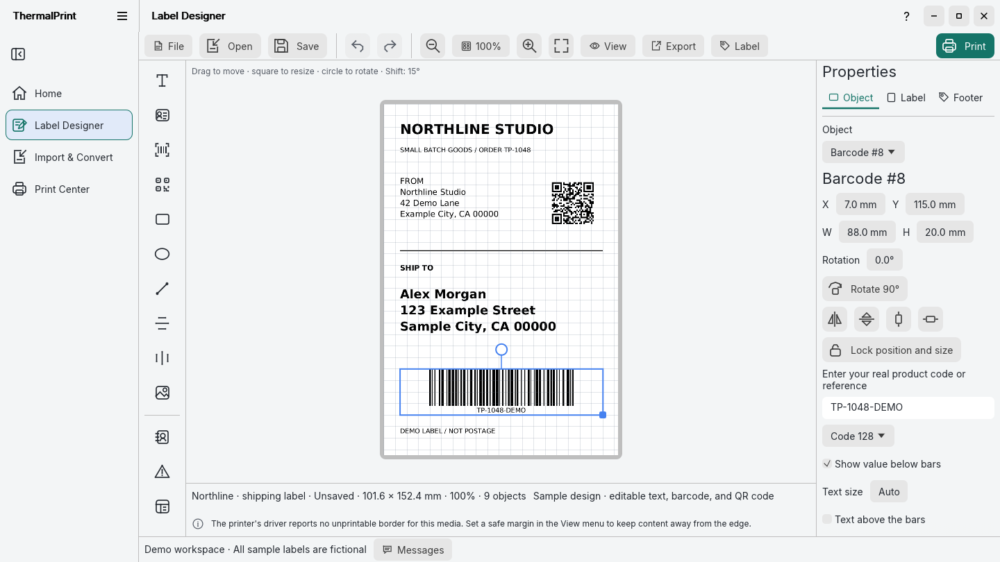

<div align="center">


# ThermalPrint

**Design, prepare, and print labels on Linux and Windows 11.**

Design custom labels, prepare downloaded PDFs, and print on thermal stock—all in one local workspace. ThermalPrint uses CUPS on Linux and the Windows print spooler on Windows 11. It also works with regular laser and inkjet printers when you choose a supported paper size such as A4 or Letter.

[](https://github.com/arios4k/thermalprint/releases/latest)
[](https://github.com/arios4k/thermalprint/actions/workflows/ci.yml)
[](https://github.com/arios4k/thermalprint/actions/workflows/release-rpm.yml)
[](#debian--ubuntu)
[](https://copr.fedorainfracloud.org/coprs/arios/thermalprint/)
[](https://arios4k.github.io/thermalprint/manual/)
[](https://snapcraft.io/thermalprint)
[](LICENSE)

[User manual](https://arios4k.github.io/thermalprint/manual/) · [Install on Fedora](#fedora) · [Install on Debian / Ubuntu](#debian--ubuntu) · [Download packages](https://github.com/arios4k/thermalprint/releases/latest)

<picture>
  <source media="(prefers-color-scheme: dark)" srcset="docs/screenshots/designer-dark.png">
  
</picture>

<sub>Actual app screenshots from the current source, with fictional sample data. The demo label is not postage. Light and dark images follow your GitHub theme.</sub>

</div>

## A workspace for everyday labels

ThermalPrint keeps three jobs in one clean window: **design** your own labels, **prepare** the labels carriers and marketplaces send you, and **print** them on thermal or regular printers.

### Design your own

- **Templates and real codes.** Text, addresses, logos, shapes, shipping symbols, real barcodes (including GS1) and QR codes, with six built-in fonts chosen for labels, or any font on your computer.
- **Precise layout.** Alignment and distribution tools, smart guides, a grid, exact millimeter fields, free rotation, and saved templates.
- **A tidy workspace.** A grouped toolbar with **Print** always at the right, and a properties panel with **Object**, **Label**, and **Footer** tabs.
- **Safe barcodes.** A warning appears as soon as a barcode or QR code overlaps another object, and Print stays off until it is fixed, while the canvas stays editable.
- **Sign your designs.** An optional footer message, with or without a QR code, aligned left, center, or right. It uses only blank space inside the printable area and never changes the label size. Imported shipping labels never get one.

### Prepare existing labels

- **Smart cropping.** Import PDFs or images, crop away instructions and whitespace while keeping every part of the label that has a barcode, and review the result before printing.
- **A focused sidebar.** The **Label** tab walks you through extract, paper, and print. The **Automation** tab holds the watch folder, automatic printing, and background printing.
- **Save clicks.** Watch a folder such as Downloads so new labels join the queue, even ones saved while the app was closed, and optionally print them by themselves.

### Print with confidence

- **Get the size right.** Start at **4 × 6 inches** or any size; ThermalPrint explains printer media and matches the output to it. Wide labels can be designed on their side and rotated 90° when they print.
- **Print Center in three tabs:** **Printer** with a step-by-step setup assistant, **Label stock** profiles you switch, update, and delete from an always-visible **Active profile** menu, and **Recent prints** with confirmed reprints.
- **Any paper your printer supports.** Label sizes on thermal printers, and Letter, Legal, A4, and more on office printers.
- **Print many at once.** Numbered runs, several labels on one sheet of any paper size, and one label per row of a spreadsheet.
- **Print or export.** Print to a configured system printer, or save a PDF, PNG, SVG, or raster ZPL or TSPL. Zebra-compatible and TSPL shipping printers can also be sent ZPL or TSPL directly.

### Made for everyone

- **Its own look.** A teal accent, a clean interface font, an icon and a name on every button, and window controls that match Windows or Linux. Light and dark mode follow your system, and a compact layout suits small screens.
- **Accessible.** Every control works from the keyboard with a visible focus ring, screen readers hear a name for every button and tab, and text meets WCAG AA contrast in light and dark mode.
- **In your language.** English, Spanish, German and French, plus a built-in guide to printing terms.

Document processing happens on your computer. ThermalPrint works with local files from carriers and marketplaces, including Vinted, eBay, Etsy, Shopify, USPS, UPS, and FedEx, without connecting to their accounts.

## Manual

**To learn how to use ThermalPrint, read the [ThermalPrint Manual](https://arios4k.github.io/thermalprint/manual/).** It explains every part of the app step by step: importing labels, the Label Designer, barcodes, batch printing, Print Center, automation, export, settings and troubleshooting. It also opens from the app with **F1** or the **?** button.

## Install

### Windows 11

ThermalPrint is available for Windows 11 x64 in the Microsoft Store. Install the latest Store version; updates appear after Microsoft certification. ThermalPrint’s source code is MIT-licensed on both platforms. ThermalPrint is **free** on both platforms, including the Microsoft Store edition. [Microsoft Store listing](https://apps.microsoft.com/detail/9NXDXRSQW0ZF) · [Windows setup guide](https://arios4k.github.io/thermalprint/manual/install.html#windows-11)

Add your printer in **Settings → Bluetooth & devices → Printers & scanners**. Then open **Print Center** in ThermalPrint, refresh the printer list, and select the media size that matches your stock. PDF rendering is bundled in the Windows package.

### Linux

Linux packages include the application, desktop launcher, icons, CUPS client tools, and Poppler PDF utilities. Configure your printer in your desktop's printer settings, then launch **ThermalPrint** from the applications menu.

### Fedora

For **Fedora 44 and 45, x86_64**, enable the community Copr repository once:

```sh
sudo dnf install dnf5-plugins
sudo dnf copr enable arios/thermalprint
sudo dnf install thermalprint
```

Updates arrive through normal DNF updates. [View the Copr repository](https://copr.fedorainfracloud.org/coprs/arios/thermalprint/). Copr is separate from Fedora's official package repositories.

### Debian / Ubuntu

The signed APT repository provides **amd64** packages:

```sh
sudo apt update
sudo apt install curl
sudo install -d -m 0755 /etc/apt/keyrings
curl -fsSL https://arios4k.github.io/thermalprint/key.asc | sudo tee /etc/apt/keyrings/thermalprint.asc >/dev/null
echo 'deb [arch=amd64 signed-by=/etc/apt/keyrings/thermalprint.asc] https://arios4k.github.io/thermalprint/ stable main' | sudo tee /etc/apt/sources.list.d/thermalprint.list >/dev/null
sudo apt update
sudo apt install thermalprint
```

Updates arrive through normal APT updates.

### Snap

Install from the [Snap Store](https://snapcraft.io/thermalprint) (amd64). Tagged releases are published there automatically, and Snap updates itself:

```sh
sudo snap install thermalprint
```

Printing, removable drives and double-clicking `.thermalprint` files need a one-time connection step; see [Snap](https://arios4k.github.io/thermalprint/manual/snap.html) in the manual.

### Standalone packages and source builds

[GitHub Releases](https://github.com/arios4k/thermalprint/releases) contains the published packages. Tagged releases with the Fedora workflow produce a binary RPM for each supported Fedora version and a source RPM, alongside the Debian package.

Install a downloaded package using your distribution's package manager so its dependencies are installed too:

```sh
# Debian / Ubuntu
sudo apt install ./thermalprint_*.deb

# Fedora — choose the RPM matching your Fedora release
sudo dnf install ./thermalprint-*.x86_64.rpm
```

Run these from the download folder, keeping only the RPM matching your Fedora release there. Other Linux users can [build from source](#build-from-source).

## Formats and compatibility

| Task | Supported formats or options |
| --- | --- |
| Import | PDF, PNG, JPEG, TIFF, BMP, WebP; multipage PDFs join the queue; CSV, semicolon, or tab-separated tables for batch printing |
| Editable designs | Versioned `.thermalprint` files with embedded images |
| Barcodes | Code 128, Code 39, Code 93, EAN-13, EAN-8, UPC-A, ITF, Codabar, Data Matrix, GS1-128, GS1 Data Matrix, QR |
| Output | PDF, PNG; design SVG with embedded raster output; raster ZPL and TSPL |
| Layout | Automatic/manual/full-page extraction, rotation, fit/actual/custom scale, margins |
| Print resolution | 203, 300, or 600 DPI |
| Desktop | Linux with X11 or Wayland and a configured CUPS printer, or Windows 11 x64 and an installed Windows printer |

ThermalPrint prepares labels; it does not purchase postage or generate carrier tracking numbers. Raw ZPL and TSPL require a compatible printer and a deliberately configured raw queue. This is an early release: check a physical test print and scan before relying on a shipping workflow. The app does not currently decode imported barcodes or verify physical scan quality. See the [manual](https://arios4k.github.io/thermalprint/manual/) for processing limits and printer details, and [Troubleshooting](https://arios4k.github.io/thermalprint/manual/troubleshooting.html) when a print comes out wrong.

## Build from source

On Linux, you need **Rust 1.96+**, a C/C++ build toolchain, and the usual Linux development libraries. Install CUPS client tools and Poppler utilities for printing and PDF fallback support. On Windows, see the [Windows build and packaging instructions](packaging/windows/README.md).

```sh
git clone https://github.com/arios4k/thermalprint.git
cd thermalprint
cargo run --release --locked
```

PDFium is optional. To use a custom installation, set `THERMALPRINT_PDFIUM_DIR` to the directory containing `libpdfium.so`.

[User manual](https://arios4k.github.io/thermalprint/manual/) · [Snap packaging](docs/SNAP.md) · [Development and tests](docs/DEVELOPMENT.md) · [Fedora packaging / Copr setup](packaging/rpm/README.md) · [APT release maintenance](docs/RELEASING.md) · [Regenerate screenshots](docs/screenshots/README.md)

## Support ThermalPrint

If ThermalPrint has been useful to you, please consider [making a donation of any amount](https://paypal.me/AlexisRios) to help keep the project running and support its continued development. Every contribution is appreciated.

ThermalPrint is free on Linux and Windows. Optional donations support continued development.

[](https://paypal.me/AlexisRios)

[Privacy policy](docs/PRIVACY.md)

If ThermalPrint is useful to you, a [GitHub star](https://github.com/arios4k/thermalprint), a reproducible [bug report](https://github.com/arios4k/thermalprint/issues), or sharing it with another Linux user helps the project grow. Keep personal addresses and tracking information out of public reports.

Created by **Alexis Rios-Negron**. Also explore [Voltkit](https://github.com/arios4k/voltkit) and [Battery Health Center](https://github.com/arios4k/battery-health-center).

## License

[MIT](LICENSE) © 2026 Alexis Rios-Negron. Bundled fonts and dependencies retain their own licenses.
