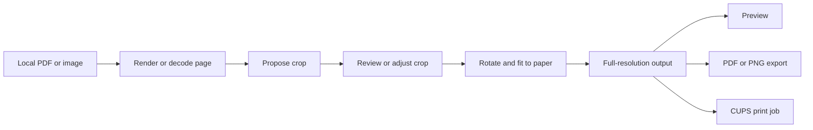

# Using ThermalPrint

[Back to the project](../README.md)

## First label: a downloaded PDF

1. Download your shipping label PDF from its carrier or marketplace.
2. Open ThermalPrint and choose **Add labels**, or drag the PDF into the window.
3. Inspect the automatic crop in **Original / crop**. If instructions or several content groups are present, select the appropriate region. Use **Manual** to draw, move, or resize a crop when needed.
4. Check the preview for every address, tracking number, carrier mark, and barcode quiet zone. Confirm **I checked the crop and barcode edges** when the app asks you to review a crop.
5. Select **4 × 6 in**, your printer, and the matching media advertised by its driver. Choose **Print label**. Alternatively, export a PDF or PNG for inspection.

For a correctly sized 4 × 6 source, the automatic proposal may be the whole page. You can always switch to Full page.

## 📦 Printing several labels

Choose several files in **Add labels**, or drop several files together. Each PDF page is added as a queue entry. When Automatic mode finds multiple separated regions on one page, **Queue all detected regions** replaces that page's current queue entry with one entry per proposed region.

Select each entry in the queue to inspect and adjust it. Crops, extraction mode, and review state are remembered per queue entry. Use **Move up**, **Move down**, and **Remove** to arrange the print order. **Print all** requires every entry to be reviewed and submits the jobs to CUPS **one after another in queue order**. Unless **Keep going if a label fails** is ticked, the batch stops at the first load, layout, or CUPS error and reports how many jobs were submitted; with that option on, failed labels are skipped, stay in the queue, and are listed in the message. **Skip review for automatic crops** treats labels added afterwards as reviewed, so use it only for layouts you trust. A thumbnail strip, **Alt+Left** / **Alt+Right**, and a second row above the preview (previous/next, **Reviewed**, and a green **Print** button) make it quicker to move through and print the queue; **Ctrl+Enter** prints the current label and shows the next one. Submission order is not a guarantee of physical print completion; use **Job status** and the printer itself to check progress.

Paper size, DPI, rotation, margins, scaling, enhancement, printer, media, resolution, and copies are shared settings for the batch. The app re-renders each queued page at print resolution when submitting it. A label that would clip is blocked rather than silently cut off.

## 🎨 Design a label from scratch

Open **Label Designer** and choose a blank canvas or one of the built-in templates. Set width and height in millimeters, then add text, a proper Code 128/Code 39/EAN-13/UPC-A barcode, a QR code, a shape, or an image. Click an object to edit its content and exact geometry in the properties inspector. Drag it on the canvas or drag its resize handle; Shift-click selects several objects. The toolbar provides undo/redo, zoom, grid/snap controls, save/open, export, and printing. Designs are saved as `.thermalprint` files with a versioned JSON schema and embedded image data.

The editor renders output at the selected printer DPI in a background worker. Save/print/export jobs run separately from the canvas. Design PDF and PNG export use the full-resolution output, while SVG export wraps that raster output in an SVG container. ZPL export uses `^GFA` raster data at the selected DPI; direct ZPL printing requires a CUPS raw queue configured for a ZPL-compatible printer. Selecting a regular PDF queue for raw ZPL will not work. The app does not create or certify postage, carrier service marks, or tracking numbers.

### Built-in templates

Blank 4 × 6, shipping, return address, product barcode, inventory, QR code, asset tracking, shelf, price tag, name, and fragile layouts are included. Template text and code values are examples: replace them with your own data before printing. Saved `.thermalprint` designs can be reopened and reused.

## 🔍 Extraction and layout

### Automatic

Automatic mode identifies non-white content and proposes an outer crop with a safety buffer. It also looks for horizontal or vertical whitespace gaps that separate content groups. When a label-shaped region clearly dominates a separate instruction block, the proposed crop includes only the label, so those instructions are absent from the **processed preview**, export, and print. The original view still shows the entire document. If several regions are similarly plausible, Automatic keeps the full page until you select a candidate. A cropped proposal with excluded content requires your review before printing. This is layout analysis, not a carrier-specific label recognizer or proof that every carrier instruction was identified.

### Manual

Switch to **Original / crop**. Drag on the page to draw a crop, drag inside it to move it, or drag a corner to resize it. The green boundary describes the crop on the **original**, before rotation. The source document is never modified. Confirm the crop after checking its edges.

### Full page

Fits the complete page to the selected paper. This is useful when the source is already a label, when boundaries are ambiguous, or when you need to preserve everything on the page.

### Fit, actual size, and custom scale

- **Fit within paper** preserves aspect ratio and scales the selected crop to the usable area inside the margins.
- **Actual size** uses the source's physical size. For raster images without a reliable physical size, ThermalPrint currently assumes 300 DPI.
- **Custom scale** applies the chosen percentage to that physical size.

The app warns when content is reduced substantially or source pixels are enlarged. If an actual-size or custom-scale layout exceeds the available area, output is marked clipped and printing/export is blocked until you adjust it. Source PDF pages are rasterized at 300 DPI, independently of the preview texture.

### Barcode care

ThermalPrint keeps proportions, centers content, and adds a crop buffer to help protect barcode quiet zones. Enhancement is **off by default**; its black-and-white threshold can harm thin bars. Inspect the original and processed preview, and print a test label. A successful PDF export or CUPS submission does **not** prove that a physical barcode will scan. ThermalPrint currently does not decode or validate barcodes, and enlarging low-quality pixels cannot restore lost detail.

## 🖨️ CUPS and printer setup

ThermalPrint uses the Linux CUPS client programs rather than brand-specific printer commands. It queries printer queues with `lpstat` and supported options with `lpoptions -l`. The selected output is sent through `lp` as a one-page PDF, with CUPS scaling disabled and the selected media and copy count supplied as job options.

1. Add your printer in your desktop's printer settings or CUPS administration interface.
2. Confirm the queue advertises the paper you loaded (for example, a 4 × 6 media choice). Select **Custom** only if the driver advertises it; ThermalPrint sends the exact output dimensions in millimeters.
3. Choose an advertised resolution if available, or leave the driver's default.
4. Print a test label and check the printer's physical margins, orientation, contrast, and feed behavior.

Print Center shows descriptive driver media names and a readiness summary. If the output size differs from the selected stock, **Match output to printer media** sets the output dimensions to that stock. In Label Designer, **Match label to printer media** resizes the canvas while preserving object sizes and positions; Undo can reverse it. If the smaller label size is intentional, choose matching printer media instead.

Printing terms such as CUPS and DPI have contextual help. **☰ → Printing terms** opens the searchable glossary.

The printer panel gives a **best-effort hint** when a queue name or advertised media suggests a label printer. CUPS does not expose a definitive “thermal printer” flag, and a hint does not establish driver compatibility. Printer names and media choices come from your local CUPS configuration. Zebra, Rollo, Brother, ORGSTA, and other printers can work when their CUPS driver or driverless queue accepts the chosen media and PDF jobs. The ORGSTA hint is based on the queue name, not a driver guarantee. Raw ZPL is available only through a compatible CUPS raw queue.

**Job status** reports CUPS printer and pending-job information. A successful `lp` result means the scheduler accepted the job; it does not confirm that the printer physically produced a readable label.

## 💾 Export files

- **PDF:** One image-only page. The PDF `MediaBox` matches the paper dimensions in PDF points; the embedded image retains the selected output pixel dimensions.
- **PNG:** The output canvas is stored at the chosen pixel dimensions with pixels-per-meter metadata derived from 203, 300, or 600 DPI.
- **SVG for designs:** An SVG document with the output raster embedded. It retains the physical page size but is not editable vector artwork.
- **ZPL for designs:** Raster `^GFA` generated from the rendered canvas. The printer must support ZPL and receive it through a raw queue.

The export is produced from the full processing pipeline, not from a screenshot of the preview widget. The original input file remains untouched. Output is written through a temporary file and renamed into place after the write completes.

## 🔒 Settings, privacy, and limits

Preferences are saved as JSON in the user configuration directory selected by the [`directories`](https://docs.rs/directories/) crate. They include recent **file paths**, the last printer and media choice, paper and layout controls, copy count, theme choice, and related options. Window state is handled by eframe's persistence support. Imported document content is processed locally; ThermalPrint does not upload labels or contact marketplaces.

Safety limits include a 256 MB input-file limit, a 45-megapixel page/image limit, and a 36-megapixel output limit. These bounds reduce accidental memory exhaustion but are not a hardened sandbox for untrusted documents. PDFium is a native shared library when used; Poppler utilities are an external runtime fallback. Encrypted or damaged PDFs may need to be re-exported before import.

Other current limits:

- Automatic extraction can mistake a large instruction block for another candidate, or miss a border with little whitespace. Review every proposal.
- A PDF page is rasterized at 300 DPI. Details already missing from the source cannot be recovered.
- The preview cannot predict physical printer calibration, heat, driver margins, or carrier scanner behavior.
- Printer capabilities depend on what the CUPS queue advertises; the app does not install or repair drivers.
- The queue is saved as you work. After the app closes, the next start offers to **Restore** or **Discard** it; restored labels keep their crops but must be reviewed again, and files that were moved or deleted are left out.
- There is no imported-barcode decoder, marketplace integration, or automatic download feature yet (the watch folder picks up files you download yourself). Designer ZPL is raster based and requires a compatible raw queue.

## Saved label files

Installed packages register `.thermalprint` files as **ThermalPrint label designs**.
Double-click a saved design to launch ThermalPrint directly in Label Designer.
PDFs and images continue to open in Import & Convert. You can also drop a single
`.thermalprint` file onto ThermalPrint to open it in the Designer.

When a design has unsaved changes, closing the app, creating a new label,
choosing a template, or opening another design offers **Save**, **Discard**, and
**Cancel**. Cancelling or a failed save preserves the current design.

Select an object in Label Designer to reveal its handles. Drag the round handle
above it to rotate freely around its center; hold **Shift** to snap to 15° steps.
The **Rotation** field accepts precise angles, including fractional degrees.
The corner handle resizes along the rotated object's own axes. Rotation is
included in saved designs, previews, printing, and exports.
